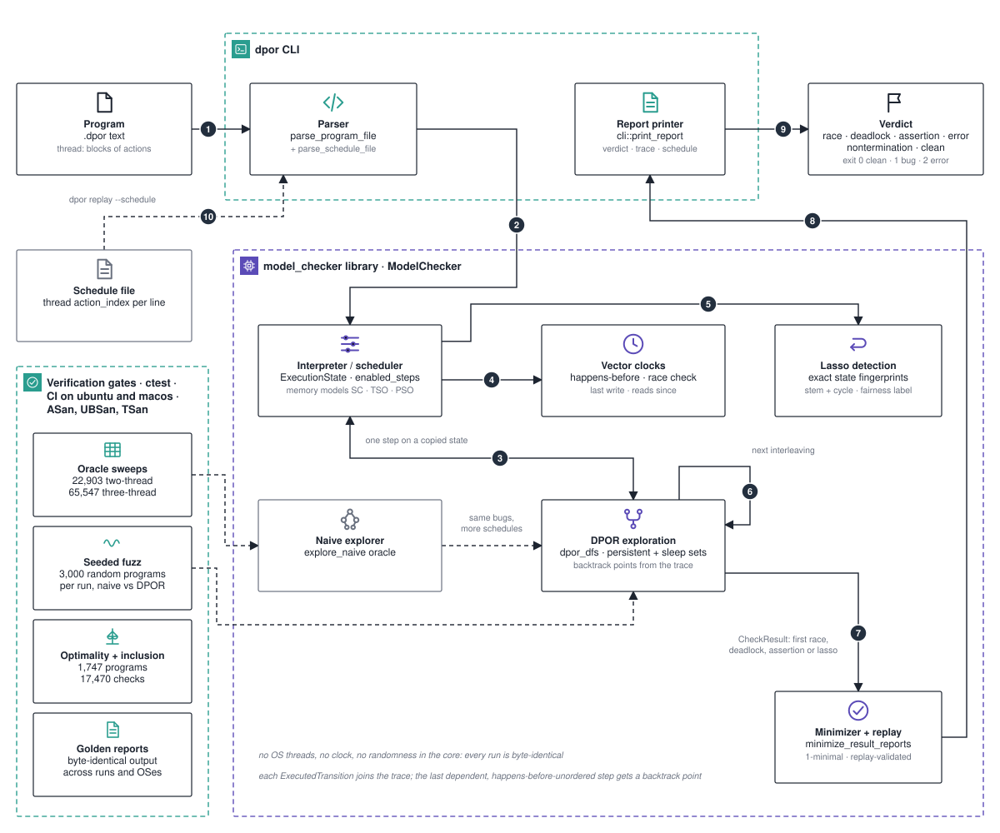

# Architecture

A deterministic model checker for concurrent programs. A program is written in a small text form, one `thread:` block per thread, and the checker runs every interleaving that can behave differently, using dynamic partial-order reduction (DPOR) to skip the ones that cannot.

This page is the map: the parts, how one `dpor check` run moves through them, and where the guarantees are proven. The numbers on the diagram match the list below. The execution model, the happens-before rules and the reduction itself are explained in [`../ARCHITECTURE.md`](../ARCHITECTURE.md); the rules the code must never break are in [`../INVARIANTS.md`](../INVARIANTS.md).

## One `dpor check` run

1. **Program → parser.** `dpor check prog.dpor [--explorer naive|dpor] [--memory-model sc|tso|pso] [--max-schedules N] [--step-bound N]` reads the text program. `cli::parse_program_file` builds a `model::Program`; a parse error exits with code 2.
2. **Parser → interpreter.** The CLI constructs `ModelChecker(program, step_bound, memory_model)` and calls `explore_dpor(max_schedules)` or `explore_naive`.
3. **Interpreter ↔ DPOR exploration.** At every node of the depth-first search the interpreter computes `enabled_steps` over the current `ExecutionState` (program counters, registers, memory cells, mutexes, read-write locks, semaphores, barriers, condition variables, and the TSO or PSO store buffers). `dpor_dfs` pushes a `DporNode` holding the enabled set, the backtrack set, the done set, the sleep set and a state snapshot, then executes one step on a copy of the state.
4. **Interpreter → vector clocks.** Each executed step ticks the thread's `VectorClock`, applies the join rule for the primitive involved, and records the access against the cell's last write and the reads since it. A conflicting access that is not ordered by happens-before produces a `RaceReport`.
5. **Interpreter → lasso detection.** When a program can loop, the interpreter fingerprints the exact behavioural state along the current path. A repeated fingerprint yields a `NonTerminationReport` with the stem, the cycle and a fairness label.
6. **DPOR exploration → earlier nodes.** After a step, the search scans the trace backward for the last dependent transition that is not happens-before ordered before the new one, and adds the new thread to that node's backtrack set (evicting it from the sleep set). When the thread was disabled there, enabler chains or the repair step add what is needed. On return, `next_unexplored_backtrack` picks the next thread from `backtrack \ done` and the next interleaving begins.
7. **DPOR exploration → minimizer.** A leaf counts as a schedule; a terminal state produces a deadlock, model error, assertion failure or lasso report, or notes that the step bound was exceeded. The first `CheckResult` is passed to `minimize_result_reports`, which deletes steps greedily and replays after each deletion so the bug stays the same bug. The result is 1-minimal, not globally minimal.
8. **Minimizer → report printer.** `cli::print_report` writes `verdict:`, the counts (`schedules_explored`, `cycles_detected`, `bound_exceeded_executions`, `exploration_capped`), any `also_found:` entries, the report block, the `trace:` and a `schedule:` block.
9. **Report → verdict.** The verdict is one of `race`, `deadlock`, `error`, `assertion`, `nontermination`, `clean up to bound` or `clean`. Exit code 0 means clean, 1 means a bug was found, 2 means the input or invocation was invalid.
10. **Schedule file → parser (replay).** `dpor replay prog.dpor --schedule f` parses the program and a schedule (`thread action_index`, plus a flush address for PSO), drives the same interpreter step by step, rejects disabled or out-of-range steps with exit 2, and prints a report identical to the one `check` printed. That identity is an invariant, not a convenience.

The naive explorer walks every interleaving and serves as the oracle: it must find the same bugs with more schedules. The gates below hold the two to that.

## Components

| Component | Responsibility | Where to look |
| --- | --- | --- |
| Program text | A `.dpor` file: `thread:` blocks of actions over named cells and registers `r0` to `r7`; `spawn` creates threads dynamically | `examples/`, grammar in `README.md` |
| Parser | Text to `model::Program`; schedule files for replay | `src/cli/program_parser.cpp` |
| Interpreter / scheduler | Small-step semantics over `ExecutionState`; `enabled_steps`, `execute_enabled_step`; SC, TSO and PSO memory models | `src/model/checker.cpp` |
| Vector clocks | `VectorClock` with `tick`, `join`, `happens_before_or_equal`; per-primitive join rules; race detection | `src/model/vector_clock.cpp`, `checker.cpp` |
| Independence | Action-level `independent()` and `may_conflict()`, refined per transition for joins, try-locks, read locks, barriers and buffered writes | `src/model/action.cpp`, `checker.cpp` |
| DPOR exploration | `explore_dpor` with persistent sets, sleep sets and happens-before-aware backtracking; `explore_naive` as the exhaustive oracle | `checker.cpp` |
| Lasso detection | Exact state fingerprints in a path-local history; stem and cycle witness; fairness label | `checker.cpp` |
| Minimizer and replay | `minimize_result_reports`, `replay` | `include/model/checker.hpp`, `checker.cpp` |
| Report printer | Text report with the `schedule:` block | `src/cli/report.cpp`, `src/cli/main.cpp` |
| Verification gates | Oracle sweeps, seeded fuzz, optimality meter, cross-model inclusion, golden reports | `tests/`, `tests/golden/`, `CMakeLists.txt` |
| Showcase export | Read-only schedule collection and inspection to JSON with `CURATED` or `MEASURED` provenance | `showcase/` |

The build produces the `model_checker` static library (public API under `include/model/`), the `dpor_cli_lib` library, the `dpor` binary, `dpor_showcase_export`, and the test executables. CMake 3.20 or newer, C++20, Release by default.

## Boundaries

- **Nothing runs concurrently.** The program under test is interpreted; there are no OS threads, no wall clock and no randomness in the core. Choice order comes from sorted containers. Timeouts are explicit schedule transitions. The same input gives byte-identical output on every run and every platform in CI.
- **What the checker assumes.** A finite program in the `.dpor` form with int64 registers and named cells starting at zero; atomics are sequentially consistent per location; relaxed atomics are not modelled; semaphores carry the declared strong happens-before. A `clean` verdict is relative to `--step-bound` (default 2000) and `--max-schedules` (default 100000); `clean up to bound` says so explicitly.
- **Where traces live.** In memory as a `Schedule` (`vector<ScheduleStep{thread, action_index, optional flush_address}>`), and on disk only as text: the `schedule:` block of a report, `showcase/schedules/*.schedule`, and `tests/golden/*.txt`.

## What is proven, and where

| Claim | Evidence |
| --- | --- |
| DPOR may over-explore but never drops a bug-exposing trace class; the naive explorer is complete for the modelled semantics | `INVARIANTS.md`, ADR 0003, the oracle sweeps |
| Oracle sweeps agree on 22,903 two-thread programs (64,582 naive versus 35,705 DPOR schedules) and 65,547 three-thread programs (770,547 versus 339,177) | `README.md`, "Verification gates" |
| Seeded fuzz: 3,000 random programs per run compared against the oracle; TSO and PSO sweeps on 11,877 and 6,707 programs; cross-model inclusion on 1,747 programs, 17,470 checks | `README.md`, `tests/` |
| Optimality: DPOR explores 1.067× (SC), 1.152× (TSO) and 1.154× (PSO) the optimal schedule count; 93.4 % of 7,162 metered programs are optimal | `README.md`, [`case-study.md`](./case-study.md) |
| Every report replays identically; minimisation is 1-minimal; a lasso is an existence proof whose fairness label describes the witness, not the program | `INVARIANTS.md`, ADR 0031 |
| Two real soundness bugs were caught by the gates during development | [`case-study.md`](./case-study.md) |

There is no pruning certificate: the reduction is checked empirically against the oracle, not proven per run. ADR 0031 records that decision.

## Facts the code relies on

- Namespaces `model::` and `cli::`. Report kinds: `RaceReport`, `DeadlockReport`, `ModelErrorReport`, `AssertionFailureReport`, `NonTerminationReport`.
- Memory models `SC`, `TSO`, `PSO`. PSO flush steps carry a third number in the schedule and use `kFlushActionIndex` (4294967295).
- Fairness labels: `unfair-schedule witness`, `strongly-unfair-schedule witness`, `fair divergence`.
- CI builds Release on Ubuntu and macOS, runs ctest, and adds Clang ASan+UBSan and TSan jobs that run the bounded `sanitizer_smoke` label and skip `exhaustive`.
